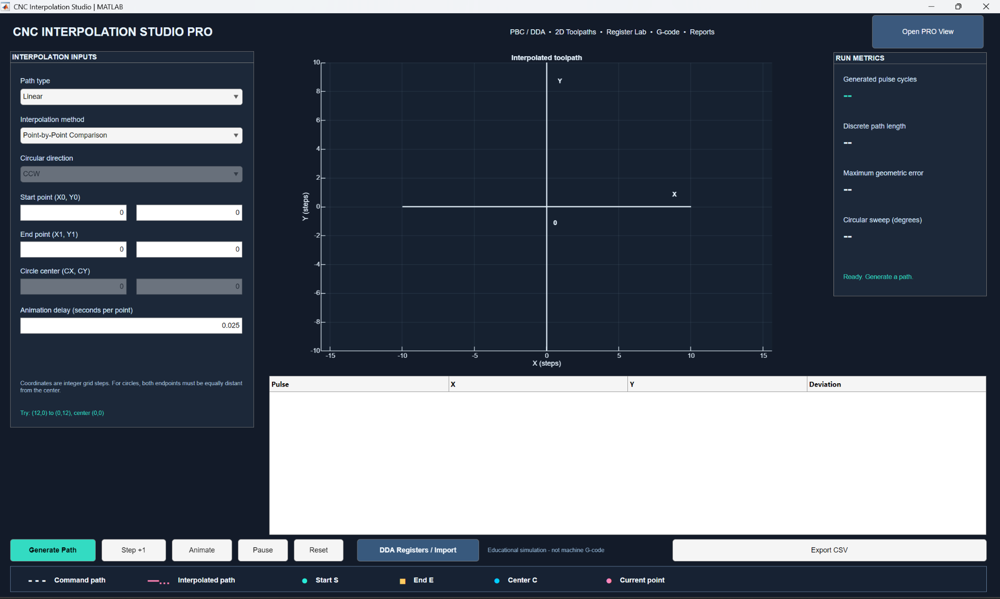
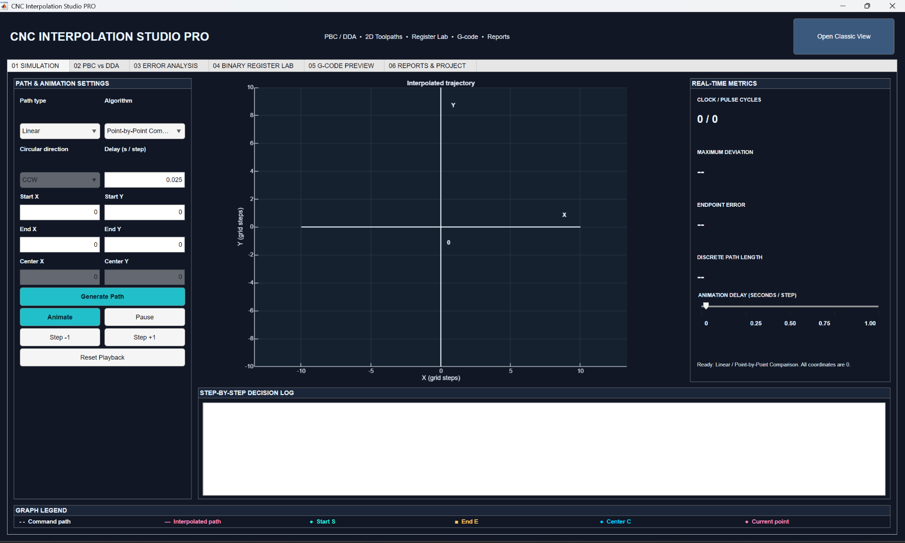
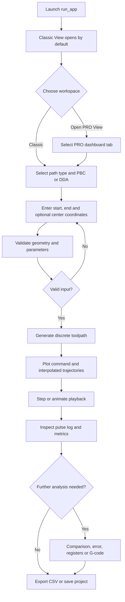
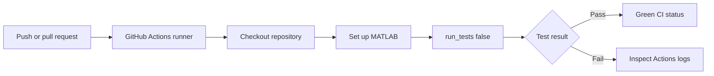
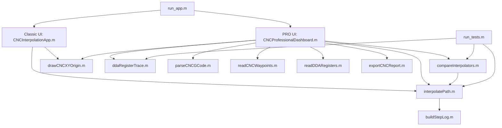

# CNC Interpolation Studio PRO

**A MATLAB App Designer-style simulator for linear and circular CNC interpolation, implementing Point-by-Point Comparison (PBC) and Digital Differential Analyzer (DDA) methods.**

[](https://github.com/ruddrho/MATLAB-Linear-Circular-Interpolation-PBC-DDA/actions/workflows/matlab-tests.yml)
[](https://www.mathworks.com/products/matlab.html)


[](LICENSE)

[**Screenshots**](#application-screenshots) · [**Quick start**](#quick-start) · [**Classic vs PRO**](#what-the-two-views-do) · [**Workflow**](#application-workflow) · [**Tests**](#testing-and-github-actions) · [**Documentation**](docs/ALGORITHMS.md)

**Author:** [RUDDRHO MOLLIK](https://github.com/ruddrho)  
**Repository:** [ruddrho/MATLAB-Linear-Circular-Interpolation-PBC-DDA](https://github.com/ruddrho/MATLAB-Linear-Circular-Interpolation-PBC-DDA)

The studio turns mathematical interpolation into an interactive learning workflow: define a 2D path, generate discrete pulses, inspect the movement step by step, compare methods, study DDA registers, and export results. It offers a focused **Classic View** and a six-tab **PRO View** for deeper analysis.

> [!IMPORTANT]
> **Educational software only.** The application is not a real-time CNC machine controller. Its G-code feature is a restricted visualization tool and must not be used directly to operate machinery.

## Quick start

From the project root in MATLAB:

```matlab
run_app                 % Open Classic View (default)
run_app('pro')          % Open the PRO dashboard directly
run_tests(false)       % Run headless automated tests
```

**Startup settings:** Linear interpolation, Point-by-Point Comparison, X/Y start/end/center coordinates all `0`, animation delay `0.025` seconds per point. Select a valid geometry and click **Generate Path** to begin.

The UI is implemented in editable MATLAB `.m` classes derived from `matlab.apps.AppBase`, **not** a binary `.mlapp` file.

## Contents

- [Quick start](#quick-start)
- [Overview](#overview)
- [Application screenshots](#application-screenshots)
- [What the two views do](#what-the-two-views-do)
- [Features and interpolation methods](#features-and-interpolation-methods)
- [Installation and quick start](#installation-and-quick-start)
- [Application workflow](#application-workflow)
- [Implementation architecture](#implementation-architecture)
- [Example simulations](#example-simulations)
- [PRO modules in detail](#pro-modules-in-detail)
- [Input files and export formats](#input-files-and-export-formats)
- [Algorithm and measurement notes](#algorithm-and-measurement-notes)
- [Project structure](#project-structure)
- [Testing and GitHub Actions](#testing-and-github-actions)
- [Troubleshooting](#troubleshooting)
- [Compatibility and limitations](#compatibility-and-limitations)
- [Author and license](#author-and-license)
- [Contributing](#contributing)

## Overview

CNC Interpolation Studio PRO demonstrates how continuous commanded motion can be approximated by a sequence of discrete X/Y pulse commands. The application supports **four interpolation combinations**: PBC–Linear, DDA–Linear, PBC–Circular, and DDA–Circular.

The project combines:

- **Interactive simulation:** enter integer coordinates, select an algorithm, generate a path, and inspect individual pulses or animate playback.
- **Engineering analysis:** compare PBC and DDA trajectories on the same geometry and review geometric deviation, endpoint error, and path statistics.
- **Register-level learning:** examine independent X- and Y-axis binary DDA accumulators, carries, and output pulses.
- **Reproducible experiments:** import example data, export results, run automated tests, and inspect the MATLAB source.

All coordinate values are expressed in **integer pulse/grid units** rather than physical units such as millimeters.

## Application screenshots

The screenshots are stored in the repository root. Click either image filename to open the full-resolution capture: [classic-view.png](classic-view.png) · [pro-view.png](pro-view.png).

### Classic View — default interface



*Classic View — default launcher: coordinate controls, XY trajectory, run metrics, pulse table, animation controls, DDA register shortcut, CSV export, and the six-key trajectory legend.*

### PRO View — advanced workspace



*PRO View — six connected workspaces for simulation, PBC-versus-DDA comparison, error analysis, binary registers, G-code preview, and project reporting.*

## What the two views do

### 1. Classic View — fast simulation and classroom demonstration

**Classic View is the default startup screen** when `run_app` is executed.

| Area | Function |
| --- | --- |
| **Interpolation inputs** | Choose Linear/Circular, Point-by-Point Comparison/DDA, circular direction, start/end/center coordinates, and animation delay. |
| **XY toolpath** | Visualize the commanded path, generated discrete points, centered `(0,0)` axes, and current interpolation point. |
| **Run metrics** | Display generated pulse cycles, discrete path length, maximum geometric error, circular sweep, and simulation status. |
| **Decision table** | Inspect the generated pulse/coordinate sequence and deviation values. |
| **Playback buttons** | Generate Path, Step +1, Animate, Pause, and Reset. |
| **DDA Registers / Import** | Access the separate register study and data-import interface. |
| **Export CSV** | Export the computed path for further analysis. |
| **Open PRO View** | Switch to the advanced dashboard using the top-right header button. |

The bottom legend distinguishes the **commanded path**, **interpolated path**, **Start S**, **End E**, **Center C**, and **Current point**. The circle controls are relevant only when Circular is selected.

### 2. PRO View — detailed comparison and engineering analysis

The PRO interface preserves the interpolation capabilities and organizes advanced tools into **six tabs**.

| Tab | Purpose | Key operations |
| --- | --- | --- |
| `01 SIMULATION` | Interactive trajectory generation | Choose interpolation geometry and algorithm; play, pause, step forward/backward; inspect the decision log and live metrics. |
| `02 PBC vs DDA` | Direct algorithm comparison | Compute both methods for identical endpoints/geometry; compare paths and summary statistics; export comparison CSV. |
| `03 ERROR ANALYSIS` | Interpolation accuracy visualization | Review point-by-point deviation curves and grouped error statistics. |
| `04 BINARY REGISTER LAB` | Study digital accumulation | Inspect `J_vx`, `J_rx`, `J_vy`, `J_ry`; move through clocks; visualize carry/overflow pulses; import/export register traces. |
| `05 G-CODE PREVIEW` | Illustrate basic CNC motion commands | Parse and preview supported G-code, inspect segments, and export the preview data. |
| `06 REPORTS & PROJECT` | Save results and working sessions | Export report/data, save/load `.mat` projects, import waypoints, and switch theme where supported. |

Use **Open Classic View** in the PRO header to return to the simpler workspace.

### Classic vs PRO — at a glance

| Capability | Classic View | PRO View |
| --- | :---: | :---: |
| Linear and circular interpolation | Yes | Yes |
| PBC and DDA method selection | Yes | Yes |
| Zero-centered XY visualization | Yes | Yes |
| Animation and step controls | Yes | Yes |
| Six-item trajectory legend | Yes | Yes |
| Pulse/decision logging | Yes | Yes |
| Live run metrics | Yes | Yes |
| Dedicated PBC-vs-DDA comparison | — | Yes |
| Error-analysis charts | — | Yes |
| Advanced binary register lab | Via separate window | Yes |
| G-code preview | — | Yes |
| Reports and project management | Basic export | Full module |

## Features and interpolation methods

### Supported modes

| Motion geometry | Point-by-Point Comparison (PBC) | Digital Differential Analyzer (DDA) |
| --- | :---: | :---: |
| **Linear** | Supported | Supported |
| **Circular (CW / CCW)** | Supported | Supported |

**PBC** makes discrete decisions about the next pulse based on the commanded geometry and a comparison/decision rule. **DDA** uses digital accumulation principles to distribute motion commands over clock updates. Both methods produce discrete trajectories that can be examined and compared.

Additional application features include centered Cartesian axes, animation timing, step navigation, sample file imports, measurement tables, and exports suitable for coursework or portfolio demonstrations.

## Installation and quick start

### Requirements

- **MATLAB R2022b or newer** (targeted release range).
- A desktop environment for interactive GUI tests and on-screen animation.
- Standard MATLAB UI components, including `uifigure`, `uiaxes`, `uigridlayout`, and `uitabgroup`.

This is a **programmatic App Designer-style application** built with MATLAB `matlab.apps.AppBase` classes stored in `.m` files. It is **not** a drag-and-drop `.mlapp` project. The supplied interpolation algorithms and UI are intended to run without additional specialist toolboxes. Some spreadsheet and export behavior may depend on MATLAB release/platform support.

### Option A: Download from GitHub

1. Open the [repository](https://github.com/ruddrho/MATLAB-Linear-Circular-Interpolation-PBC-DDA).
2. Select **Code → Download ZIP** and extract it.
3. In MATLAB, change the **Current Folder** to the extracted repository root (the folder containing `run_app.m`).
4. Enter the launch command below in the Command Window.

### Option B: Clone with Git

```bash
git clone https://github.com/ruddrho/MATLAB-Linear-Circular-Interpolation-PBC-DDA.git
cd MATLAB-Linear-Circular-Interpolation-PBC-DDA
```

Open this folder in MATLAB and run:

```matlab
run_app               % Default: Classic View
```

Other launch options:

```matlab
run_app('classic')    % Explicitly open Classic View
run_app('pro')        % Open PRO View directly
```

You can also instantiate the interfaces by their class names (`CNCInterpolationApp` and `CNCProfessionalDashboard`) when working with the source.

### Startup defaults

| Parameter | Default |
| --- | --- |
| Initial interface | Classic View |
| Path type | Linear |
| Algorithm | Point-by-Point Comparison |
| Start X / Start Y | `0` / `0` |
| End X / End Y | `0` / `0` |
| Center X / Center Y | `0` / `0` |
| Animation delay | `0.025` seconds per point |

No path needs to be generated on startup. For Circular mode, select valid center/endpoints before using **Generate Path**.

## Application workflow

### User workflow



### Working with Classic View

1. Select **Linear** or **Circular** interpolation.
2. Select **Point-by-Point Comparison** or **DDA**.
3. For a circular path, choose **CW** or **CCW** and supply a center equidistant from the start and end points.
4. Enter the desired coordinates and click **Generate Path**.
5. Use **Step +1** to inspect one update at a time, or **Animate** to play the full trajectory. Use **Pause** or **Reset** as needed.
6. Read the metrics and decision table; select **Export CSV** to save the path.
7. Click **Open PRO View** to access comparison and advanced tools.

### Working with PRO View

1. Open **Simulation** to generate the desired path with advanced playback controls.
2. Switch to **PBC vs DDA** to compute both methods on matching geometry and review their plots/metrics.
3. Open **Error Analysis** for deviation trends and summary charts.
4. Use **Binary Register Lab** to explore accumulator states clock by clock.
5. Optionally use **G-code Preview** to visualize the supported instructional program subset.
6. Visit **Reports & Project** to export results or save the current session.

### Automated testing workflow

The repository includes `.github/workflows/matlab-tests.yml`. On pushes and pull requests, GitHub Actions checks out the repository, sets up MATLAB, and executes the headless test suite:



The badge at the top reflects the **current status of the configured GitHub Actions workflow**. A successful headless workflow validates its selected algorithm/source tests, not every interactive GUI operation or printer-dependent PDF export.

## Implementation architecture

The project separates the user interfaces from interpolation algorithms, analysis helpers, data parsers, and reporting routines. Both views reuse the same underlying MATLAB functions, allowing identical geometries to be evaluated consistently.



| Layer | MATLAB files | Responsibility |
| --- | --- | --- |
| **Entry point** | `run_app.m` | Launch Classic by default or open PRO explicitly. |
| **User interfaces** | `CNCInterpolationApp.m`, `CNCProfessionalDashboard.m` | Configure, display, animate, compare, and export simulation results. |
| **Numerical core** | `interpolatePath.m`, `compareInterpolators.m`, `buildStepLog.m` | Generate discrete paths and calculate analysis data. |
| **Register and I/O tools** | `ddaRegisterTrace.m`, `readDDARegisters.m`, `readCNCWaypoints.m`, `parseCNCGCode.m` | Simulate registers and parse supported input formats. |
| **Visualization and report** | `drawCNCXYOrigin.m`, `exportCNCReport.m` | Draw origin axes and prepare printable results. |
| **Regression tests** | `run_tests.m`, `tests/` | Validate selected algorithms, data handling, and UI-source integration. |

## Example simulations

### Example 1 — linear toolpath

In either view, select **Linear** and PBC or DDA. Try:

| Field | Value |
| --- | ---: |
| Start X / Y | `0`, `0` |
| End X / Y | `40`, `30` |

Generate the path, advance through the points, and compare the stepped trajectory with the commanded straight line. For a file-based example, see [`examples/waypoints_linear.csv`](examples/waypoints_linear.csv).

### Example 2 — counterclockwise circular arc

Select **Circular**, **CCW**, and one interpolation method. Enter:

| Field | Value |
| --- | ---: |
| Start X / Y | `12`, `0` |
| End X / Y | `0`, `12` |
| Center X / Y | `0`, `0` |

Both endpoints are 12 grid units from the center. Generate the path and inspect the resulting discrete arc. The same input is supplied in [`examples/waypoints_circular.csv`](examples/waypoints_circular.csv).

### Example 3 — 3-bit DDA register sequence

Use the Binary Register Lab with the following configuration:

```csv
J_vx,J_rx,J_vy,J_ry,NBits,Cycles
101,000,011,000,3,8
```

`J_vx=101` and `J_vy=011` represent the X/Y velocity words, while `J_rx=000` and `J_ry=000` are initial remainder registers. For this 3-bit, eight-clock example, the register simulation produces **5 X pulses and 3 Y pulses**. Inspect the per-clock accumulator and carry trace rather than treating this as the internal state of the circular interpolation solver.

See [`examples/dda_registers_example.csv`](examples/dda_registers_example.csv).

## PRO modules in detail

### PBC vs DDA comparison

The comparison module evaluates both algorithms using the same geometric inputs and reports their resulting discrete trajectories and metrics, including pulse cycles, path length, endpoint error, and geometric deviation. Execution timing is included as an **illustrative MATLAB evaluation time**, not a CNC machine feed-rate measurement.

### Error analysis

The error module visualizes discrete-path deviation from the commanded geometry. It supports per-step curves and summary comparisons; see [Algorithm and measurement notes](#algorithm-and-measurement-notes) for how the error is defined.

### Binary register lab

The register lab models an independent fixed-width, two-axis DDA accumulation example:

| Register | Meaning |
| --- | --- |
| `J_vx` | X-axis velocity/addend word |
| `J_rx` | X-axis remainder/accumulator word |
| `J_vy` | Y-axis velocity/addend word |
| `J_ry` | Y-axis remainder/accumulator word |
| `NBits` | Register width |
| `Cycles` | Number of clock updates |

Import a CSV/TXT/XLSX/MAT configuration (where supported), step backward/forward through the trace, inspect generated pulse outputs, and export the register history.

### G-code preview

The restricted interpreter provides **educational visualization** of:

| Code | Supported interpretation |
| --- | --- |
| `G00` | Rapid/positioning move preview |
| `G01` | Linear interpolation preview |
| `G02` | Clockwise circular interpolation preview |
| `G03` | Counterclockwise circular interpolation preview |
| `G90` | Absolute XY positioning |
| `G91` | Incremental XY positioning |
| `I`, `J` | Incremental center offsets for arcs |

Example program from [`examples/demo_program.gcode`](examples/demo_program.gcode):

```gcode
G90
G00 X0 Y0
G01 X12 Y0 F120
G03 X0 Y12 I-12 J0
G01 X0 Y0
```

See [`docs/GCODE_SUBSET.md`](docs/GCODE_SUBSET.md) for supported commands and limitations.

### Reports and project management

Available export/storage workflows include comparison reports (A4 PDF), path and comparison CSV, supported spreadsheet outputs, binary register trace CSV, G-code preview data, and `.mat` project save/load. PDF creation should be checked on a local graphical MATLAB installation.

## Input files and export formats

| Format | Typical use | Example / location |
| --- | --- | --- |
| `.csv` | DDA register configuration | [`examples/dda_registers_example.csv`](examples/dda_registers_example.csv) |
| `.txt` | Key/value binary register configuration | [`examples/dda_registers_key_value.txt`](examples/dda_registers_key_value.txt) |
| `.csv` | Linear XY waypoint input | [`examples/waypoints_linear.csv`](examples/waypoints_linear.csv) |
| `.csv` | Circular XY waypoint input | [`examples/waypoints_circular.csv`](examples/waypoints_circular.csv) |
| `.gcode` | Instructional G-code example | [`examples/demo_program.gcode`](examples/demo_program.gcode) |
| `.mat` | Stored project state / supported waypoint data | User-generated |
| `.xlsx` | Spreadsheet import/export where supported | User-generated |
| `.pdf` | Analysis report | User-generated |

**Binary register note:** preserve leading zeroes such as `011` by treating the source as **text**, especially in spreadsheet software.

**MAT waypoint convention:** a waypoint file can contain a scalar `waypoints` struct with `Start`, `End`, and `Center` numeric 1-by-2 vectors.

## Algorithm and measurement notes

- **Pulse/grid units:** coordinates and circle centers are integers. Reported geometric errors are in grid-step units.
- **Linear PBC:** updates produce one X *or* Y pulse at a time, depending on the comparison decision.
- **Linear DDA:** an update may generate X and Y pulses on the same clock. Therefore, pulse-cycle counts are **not directly interchangeable** between PBC and DDA.
- **Circular geometry:** start and end points must be at the **same exact integer-grid radius** from the selected center; direction may be clockwise or counterclockwise. Equal start/end positions request a full revolution in circular mode.
- **Line deviation:** perpendicular distance from a generated point to the infinitely extended commanded line.
- **Circle deviation:** absolute radial-distance difference from the commanded circle.
- **Endpoint error:** distance between the generated endpoint and the requested endpoint as computed by the comparison module.
- **CPU evaluation time:** MATLAB `tic/toc` timing is illustrative only; it is not motor time, servo lag, or an industrial performance benchmark.
- **Register lab separation:** the stand-alone binary register experiment is not a display of the circular geometric DDA algorithm's internal state.

For more implementation-oriented explanation, refer to [`docs/ALGORITHMS.md`](docs/ALGORITHMS.md).

## Project structure

```text
MATLAB-Linear-Circular-Interpolation-PBC-DDA/
├── run_app.m                       # Classic startup / optional PRO launch
├── CNCInterpolationApp.m           # Classic AppBase interface
├── CNCProfessionalDashboard.m      # Six-tab PRO AppBase interface
├── interpolatePath.m               # PBC / DDA interpolation routines
├── compareInterpolators.m          # Algorithm comparison and metrics
├── buildStepLog.m                  # Step-by-step log builder
├── drawCNCXYOrigin.m               # Centered X/Y axes and origin labels
├── ddaRegisterTrace.m              # Binary accumulator trace
├── readDDARegisters.m              # Register configuration imports
├── readCNCWaypoints.m              # Coordinate/waypoint imports
├── parseCNCGCode.m                 # Restricted G-code interpreter
├── exportCNCReport.m               # PDF report generator
├── run_tests.m                     # Headless test entry point
├── classic-view.png                # Classic screenshot (README)
├── pro-view.png                    # PRO screenshot (README)
├── tests/                          # Algorithm, source, and GUI tests
├── examples/                       # CSV/TXT/G-code sample inputs
├── docs/                           # Algorithm and G-code documentation
├── .github/workflows/
│   └── matlab-tests.yml            # CI workflow
├── .gitignore
├── LICENSE
└── README.md
```

## Testing and GitHub Actions

### Run the headless test suite

From the repository root, open MATLAB and execute:

```matlab
run_tests(false)
```

The test runner automatically adds the repository root and the `tests` directory to the MATLAB search path. The CI workflow runs `run_tests(false)` and intentionally omits GUI-only tests and the optional PDF smoke test. The suite covers interpolation cases, invalid-radius handling, DDA register sequences, comparison utilities, waypoint imports, UI/source integration, default settings, header layout, navigation, and zero-centered axes.

The test entry point uses the following sequence of checks:

| Test group | Coverage |
| --- | --- |
| Interpolation | PBC/DDA linear and circular cases, edge cases, invalid radius |
| Binary register logic | Carry/overflow, imported settings, input validation |
| Professional analysis | Comparison metrics, logs, G-code and supported parsing |
| Interface source checks | Defaults, header structure, Classic/PRO navigation, zero-origin axis code |
| Waypoint import | Structured path input validation |

A local MATLAB test session produced:

```text
All selected CNC Interpolation Studio PRO tests passed.
```

The GitHub Actions workflow reports status on pushes and pull requests; view [MATLAB Algorithm Tests](https://github.com/ruddrho/MATLAB-Linear-Circular-Interpolation-PBC-DDA/actions/workflows/matlab-tests.yml). The workflow completed successfully on the `main` branch on **8 November 2026** (including a run following screenshot uploads). The status badge above updates with future workflow runs.

### Optional desktop-only checks

These checks are separate from the standard headless CI run and may require an interactive MATLAB desktop:

```matlab
addpath('tests')
test_ui_defaults_gui
test_startup_navigation_gui
test_ui_origin_gui
```

To include the PDF smoke test in the test runner:

```matlab
run_tests(true)
```

> [!NOTE]
> Headless CI passing does **not** establish that every GUI interaction, report printer setup, or exported file works on every MATLAB release. These features should be verified in the intended desktop environment.

## Troubleshooting

<details>
<summary><strong>MATLAB cannot find ddaRegisterTrace, compareInterpolators, or another function</strong></summary>

Ensure MATLAB's Current Folder is the **repository root** (containing `run_app.m`, `ddaRegisterTrace.m`, and `compareInterpolators.m`), not the `tests` subfolder. Then run:

```matlab
addpath(pwd)
addpath(fullfile(pwd,'tests'))
rehash
which ddaRegisterTrace -all
which compareInterpolators -all
run_tests(false)
```

If you have several older project copies, `which ... -all` reveals potential path conflicts.

</details>

<details>
<summary><strong>The default figure is blank or all coordinates are zero</strong></summary>

This is intentional: startup uses **Linear / PBC / zeros** and does not auto-generate a path. Enter nonzero endpoint coordinates and click **Generate Path**. For a circular example, use Start `(12,0)`, End `(0,12)`, Center `(0,0)`.

</details>

<details>
<summary><strong>A circular input is rejected</strong></summary>

Check that the start and end coordinates are equally distant from the circle center using the integer-grid radius rule. Ensure the intended CW/CCW direction is selected.

</details>

<details>
<summary><strong>The app reports a GridLayout Position error</strong></summary>

Use the updated `CNCInterpolationApp.m`. The corrected header uses a positioned `uipanel` with a nested `uigridlayout` rather than setting a read-only grid `Position` property. Also check that MATLAB is not loading an outdated project copy using `which CNCInterpolationApp -all`.

</details>

<details>
<summary><strong>GitHub Actions is red but local MATLAB tests pass</strong></summary>

Open the failing run under **Actions → MATLAB Algorithm Tests**, expand the `matlab-actions/run-command@v2` step, and inspect the **first actual MATLAB error**. The final `exit code 1` line reports failure but does not identify its cause. Check the version of the test files committed to the repository.

</details>

## Compatibility and limitations

- **Target environment:** MATLAB R2022b or newer, with standard App Designer-style UI components.
- **Source format:** `.m` classes inheriting from `matlab.apps.AppBase`; **not** a native `.mlapp` designer file.
- **Purpose:** visualization, coursework, numerical-method study, and software demonstration.
- **Units:** discrete integer pulses/steps; there is no intrinsic millimeter conversion or machining dynamics model.
- **Motion scope:** 2D X/Y geometry only; not a controller for motors, servo loops, tool offsets, collision handling, or hardware safety.
- **G-code scope:** a deliberately restricted parser/previewer, not an industrial G-code execution environment.
- **Testing scope:** automated headless checks; optional GUI/PDF checks require local desktop execution.
- **Privacy:** no student name or student ID fields in the application; the README identifies the repository author only.

## Author and license

Developed by **[RUDDRHO MOLLIK](https://github.com/ruddrho)** as an engineering education and MATLAB software project.

- **GitHub:** [github.com/ruddrho](https://github.com/ruddrho)
- **Repository:** [MATLAB-Linear-Circular-Interpolation-PBC-DDA](https://github.com/ruddrho/MATLAB-Linear-Circular-Interpolation-PBC-DDA)
- **License:** [MIT License](LICENSE)

Contributions, issues, and reproducible test reports are welcome through the GitHub repository.

## Contributing

Bug reports and reproducible test cases are welcome through [GitHub Issues](https://github.com/ruddrho/MATLAB-Linear-Circular-Interpolation-PBC-DDA/issues). When proposing a change, include your MATLAB release, example coordinates or input file, the expected behavior, the observed result, and the output of `run_tests(false)` where applicable.

For code changes, keep interpolation logic independent of UI code and add or update regression tests in `tests/`. The CI workflow runs on pushes and pull requests.
